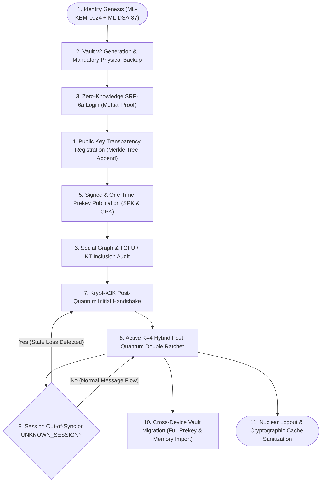
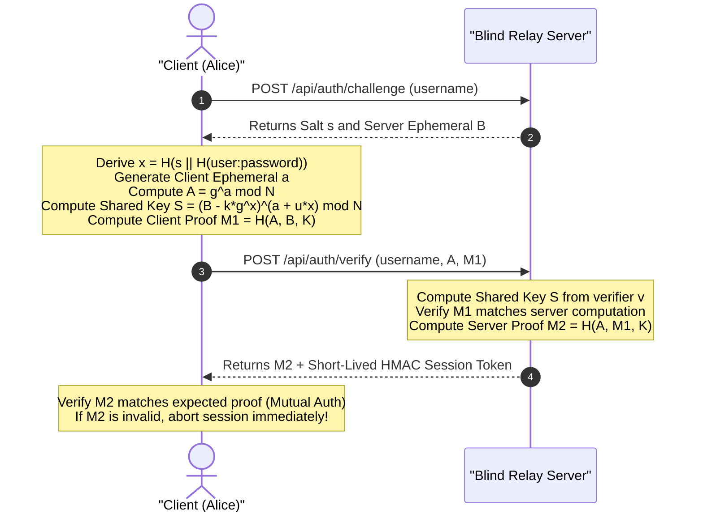
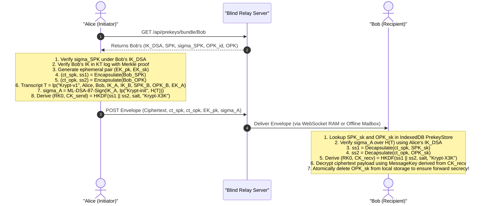
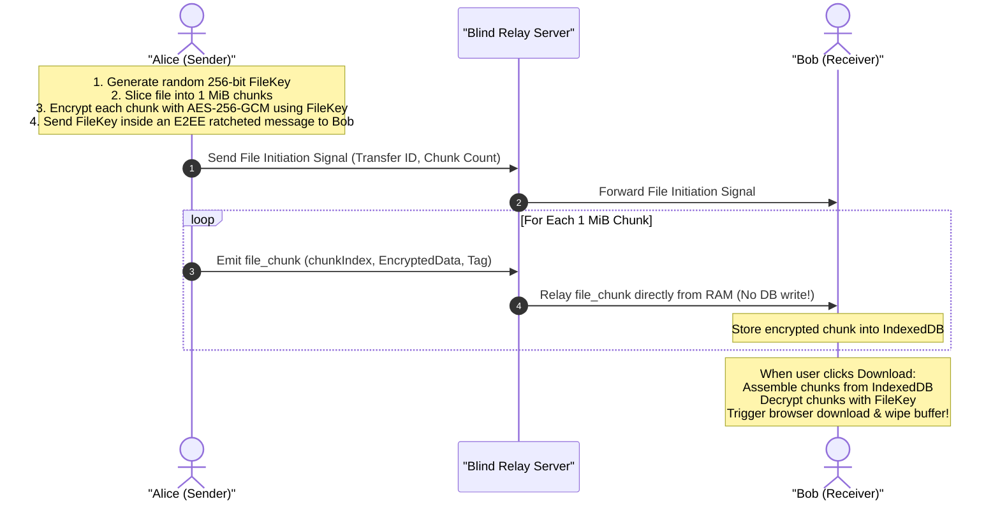

# 🛡️ Project Krypt: Complete System & Protocol Lifecycle (v1)

This document provides the definitive, normative walkthrough of the **Project Krypt (v1)** operational lifecycle. It traces the exact cryptographic transformations, state transitions, message flows, and zero-knowledge storage mechanisms across both client endpoints and the blind relay infrastructure.

---

## 🗺️ High-Level Lifecycle State Machine

The diagram below outlines the overall lifecycle states of a Krypt client identity from genesis through active ratcheted communication and device migration.

---

## 1. Identity Genesis & Sovereign Vault v2 Creation

### Goal
Generate a cryptographically sovereign, post-quantum identity on the client device without revealing private keys or master passwords to the server.

### Cryptographic Operations
1. **Asymmetric Key Generation**:
   - Long-Term Identity Signature Key: Generates an **ML-DSA-87** (FIPS 204) KeyPair:
     $$(IK_{\text{DSA, pk}}, IK_{\text{DSA, sk}})$$
   - Long-Term Identity KEM Key: Generates an **ML-KEM-1024** (FIPS 203) KeyPair:
     $$(IK_{\text{KEM, pk}}, IK_{\text{KEM, sk}})$$
2. **PAKE Credentials Generation**:
   - The client generates a random 32-byte salt $s$ and calculates the SRP-6a verifier $v$:
     $$x = \text{SHA-256}(s \parallel \text{SHA-256}(\text{username} \parallel \text{":"} \parallel \text{password}))$$
     $$v = g^x \pmod N$$
   - The master password is never transmitted across the network.
3. **Vault v2 Physical Export (Mandatory)**:
   - Before the user can access the messaging dashboard, a blocking modal enforces downloading the sovereign `.vault` file.
   - **Vault v2 Schema**: Encapsulates $IK_{\text{DSA, sk}}$, $IK_{\text{KEM, sk}}$, initial Signed Prekey private keys, One-Time Prekey private keys, replay memory, and rotation epochs.
   - **Key Hardening**:
     $$\text{VaultKey} = \text{PBKDF2-HMAC-SHA-256}(\text{password}, \text{salt}_{\text{vault}}, 600\,000, 32)$$
   - **Ciphertext**:
     $$\text{EncryptedVault} = \text{AES-256-GCM-Encrypt}(\text{VaultKey}, \text{IV}_{96}, \text{VaultPayload})$$
   - Result: If the user loses their password or vault file, the account cannot be recovered by anyone, including server operators.

---

## 2. Zero-Knowledge Authentication (SRP-6a)

### Goal
Prove ownership of the identity to the server and establish a secure authenticated transport session without sending the password.

### In-Memory Session Caching
- To avoid prompting the user for their `.vault` file on every single page refresh:
  1. The client derives a random, **non-extractable** AES-256-GCM `CryptoKey` in Web Crypto.
  2. The key object is kept in IndexedDB (`KryptSessionKeys`). The browser engine permits cryptographic operations with this key but forbids extracting its raw bytes.
  3. The decrypted identity keys are sealed under this key and stored in `localStorage`.
  4. A per-tab `sessionStorage` flag is initialized. Upon page refresh, the tab verifies the flag, decrypts the keys into RAM, and restores session state without network exposure.
  5. Closing the browser or opening an incognito tab discards `sessionStorage`, automatically revoking session access and requiring password re-entry.

---

## 3. Key Transparency Registration & Logging

### Goal
Prevent the relay server from conducting silent man-in-the-middle attacks or serving malicious public keys to unsuspecting contacts.

1. **Leaf Construction**:
   - The client constructs a canonical Key Transparency leaf body:
     $$\text{LeafBody} = \text{lp}(\text{"KRYPT-KT-v1"}, \text{OpCode} = 1, \text{userHash}, \text{keyVersion} = 1, H(IK_{\text{DSA, pk}}), H(IK_{\text{KEM, pk}}), \text{timestamp})$$
2. **Owner Signature**:
   - The user signs the leaf body using their long-term ML-DSA-87 private key:
     $$\text{OwnerSig} = \text{ML-DSA-87-Sign}(IK_{\text{DSA, sk}}, \text{lp}(\text{"KRYPT-KT-OWNER-v1"}, \text{LeafBody}))$$
3. **Append-Only Merkle Tree**:
   - The server appends the leaf hash $\text{SHA-256}(0\text{x}00 \parallel \text{LeafBytes})$ into an RFC 9162 Merkle Tree.
   - The server signs the resulting root hash and tree size, producing a **Signed Tree Head (STH)**.
4. **Independent Witness Cosigning**:
   - An isolated external witness service fetches the latest STH, computes an append-only consistency proof against its previous known root, and countersigns the STH.
   - Any attempt by the server to present a split-view or rewrite historical key registrations is instantly detected by clients via peer-to-peer STH gossip.

---

## 4. Prekey Infrastructure & Rotation

### Goal
Support asynchronous communication so Alice can send an encrypted message to Bob even while Bob is offline.

1. **Signed Prekey (SPK)**:
   - Client generates an ephemeral ML-KEM-1024 KeyPair $(SPK_{\text{pk}}, SPK_{\text{sk}})$.
   - Client signs the prekey with their long-term identity key:
     $$\sigma_{\text{SPK}} = \text{ML-DSA-87-Sign}(IK_{\text{DSA, sk}}, \text{lp}(\text{"Krypt-SPK"}, \text{SPK}_{\text{id}}, SPK_{\text{pk}}))$$
   - SPKs have an active validity period of 7 days and a grace period of 14 days.
2. **One-Time Prekeys (OPK)**:
   - Client generates a pool of 100 one-time ML-KEM-1024 KeyPairs:
     $$\{(OPK_{i, \text{pk}}, OPK_{i, \text{sk}})\}_{i=1}^{100}$$
   - Each OPK is signed and uploaded to the server's prekey registry.
3. **Atomic Consumption & Refill**:
   - When a peer initiates a handshake, the server serves exactly one OPK and removes it from the pool.
   - Bob's client automatically monitors remaining OPK inventory; when inventory drops below 20 keys, a background task generates and publishes a fresh batch of OPKs.

---

## 5. Krypt-X3K Asymmetric Handshake Flow

---

## 6. The $K=4$ Hybrid Post-Quantum Double Ratchet

Once the initial root key $RK_0$ and chain keys are established, communication enters the double ratchet phase.

### A. Symmetric Step (Per-Message)
- For every message sent or received:
  $$\text{MK} = \text{HMAC-SHA-256}(CK, 0\text{x}01)$$
  $$CK_{\text{next}} = \text{HMAC-SHA-256}(CK, 0\text{x}02)$$
- The message encryption key and 96-bit IV are derived via HKDF:
  $$\text{Key}_{\text{msg}} \parallel \text{IV} = \text{HKDF}(\text{salt} = 0^{32}, \text{ikm} = \text{MK}, \text{info} = \text{"Krypt-MK"}, 44)$$
- The plaintext is encrypted using AES-256-GCM with canonical authenticated data:
  $$\text{Ciphertext} = \text{AES-256-GCM-Encrypt}(\text{Key}_{\text{msg}}, \text{IV}, \text{Plaintext}, \text{AAD})$$
- $\text{MK}$ and the old $CK$ are immediately zeroized.

### B. Asymmetric Step (Stride $K=4$)
- When an endpoint sends 4 consecutive messages on its current sending chain, or when it receives a new ephemeral ML-KEM public key from its peer:
  1. The endpoint generates a fresh ML-KEM-1024 ephemeral keypair $(ek_{\text{new}}, dk_{\text{new}})$.
  2. It encapsulates a 32-byte shared secret $ss_{\text{new}}$ against the peer's latest key.
  3. It executes the root KDF step:
     $$RK_{\text{next}} \parallel CK_{\text{new}} = \text{HKDF}(\text{salt} = RK, \text{ikm} = ss_{\text{new}}, \text{info} = \text{"Krypt-RK"}, 64)$$
  4. The old private decapsulation key $dk_{\text{old}}$ is securely wiped from IndexedDB.
- **Benefit**: Provides post-compromise self-healing within at most 4 message intervals while conserving network bandwidth and client CPU cycles.

---

## 7. In-Band Auto-Healing Synchronization

### The Problem
If Bob logs in on a new device, restores from a backup without recent session keys, or suffers database eviction, incoming messages fail with `UNKNOWN_SESSION`. In classical protocols, this requires manual out-of-band communication or unencrypted reset signals.

### The Krypt v1 In-Band Solution
1. **Error Detection**: Bob's client fails to locate an active ratchet session for Alice's sender key. It marks the event as an unrecoverable epoch mismatch.
2. **Inline Session Notice**: Bob's UI renders a clean, centered session notice:
   `⚡ [Session Notice: Out-of-sync session detected. Re-establishing secure channel...]`
3. **In-Band Re-Handshake**: Bob's client automatically fetches Alice's prekey bundle and initiates a fresh Krypt-X3K handshake directed to Alice.
4. **Outbox Re-Sending**: Alice receives Bob's handshake, seamlessly synchronizes her session state, and flushes any pending messages stored in her encrypted local outbox under the new ratcheted keys.
5. **No Plaintext Leakage**: The recovery process occurs entirely in-band using authenticated post-quantum handshakes; zero plaintext or metadata escapes the cryptographic boundary.

---

## 8. Blind Memory Routing & Offline Mailbox

### Principles
- The backend server is a **Blind Router**. It operates purely in RAM.
- **No Disk Persistence**: Ephemeral socket messages and media attachments are never written to server disk or filesystem.

### Offline Mailbox Rules
- If the intended recipient is disconnected:
  1. The server verifies both sender and recipient have mailbox storage enabled in the database.
  2. If enabled, the encrypted ciphertext frame is buffered in the `OfflineMessage` PostgreSQL table.
  3. **Strict Quotas Enforced**:
     - Maximum Time-To-Live (TTL): 7 days (expired rows purged by periodic background cleanup).
     - Maximum Messages per Recipient: 500 messages.
     - Maximum Storage per Recipient: 50 MB total byte quota.
  4. When the recipient reconnects and authenticates, queued messages are transmitted and **atomically deleted** from the database in the same transaction.
  5. If the user toggles mailbox delivery off in settings, all waiting offline messages are immediately purged.

---

## 9. In-Flight Chunked Streaming for High-Volume Files

For arbitrary file transfers up to **256 MiB**:

---

## 10. Sovereign Cross-Device Migration (Vault v2)

1. **Source Device Export**:
   - The user requests a backup from the settings panel.
   - `IndexedDbPrekeyStore.exportAll()` extracts the user's active SPK private keys, remaining OPK private keys, SPK rotation metadata, and replay memory.
   - The payload is serialized into a Version 2 format and encrypted with PBKDF2 (600,000 rounds) + AES-256-GCM under the user's vault password.
2. **Target Device Import**:
   - The user opens Krypt on a new device and supplies the `.vault` file and password.
   - The client decrypts the vault, validates all keys, and imports the full prekey and session stores into the new browser's IndexedDB.
   - `prekeyMaintenance.ts` connects to the server, queries the server's prekey table, and reconciles state:
     - Any OPKs already consumed on the server are pruned.
     - If remaining OPKs are low, fresh prekeys are automatically generated and published.
     - Device migration completes without `UNKNOWN_PREKEY` errors or broken inbound sessions.

---

## 11. Nuclear Logout & Cryptographic Sanitization

When a user initiates a logout or selects "Wipe Local Storage":
1. **In-Memory Zeroization**: All active ML-KEM-1024 secret keys, ML-DSA-87 secret keys, ratchet chain keys, and AES-256-GCM session keys in RAM are overwritten.
2. **IndexedDB Deletion**:
   - The `krypt-v1-sessions` object store is purged.
   - The `krypt-v1-prekeys` object store is cleared.
   - The local encrypted chat history database (`KryptLocalCache`) is dropped.
3. **Session Key Destruction**:
   - The non-extractable Web Crypto AES key in `KryptSessionKeys` is deleted.
   - `localStorage` and `sessionStorage` authentication tokens and flags are removed.
4. **Socket Termination**: The WebSocket connection is severed with status code 1000 (Normal Closure), removing the client from the server's online routing tables.
